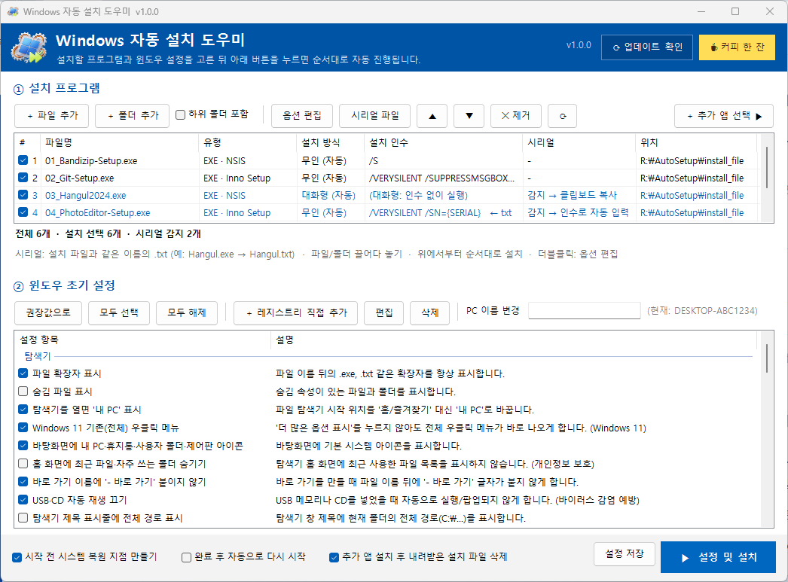

<p align="center"></p>

# Windows 자동 설치 도우미 (AutoSetup)

윈도우를 새로 설치한 PC에서 **설치 프로그램 + 시리얼 번호 + 윈도우 초기 설정**을 한 번에 처리하는 프로그램입니다.
설정을 마치고 맨 아래 **[▶ 설정 및 설치]** (설치할 것이 없으면 **[▶ 설정 적용]**) 을 누르면 순서대로 자동 진행됩니다.

`AutoSetup.exe` 하나로 실행되며 별도 설치가 필요 없습니다 (Windows 10/11 에 기본 포함된 .NET Framework 4.x 사용).

**📥 다운로드: [최신 릴리스에서 `AutoSetup.exe` 받기](https://github.com/grasion/windows-auto-setup/releases/latest)**



## 파일 구성

| 파일 | 설명 |
|---|---|
| `AutoSetup.exe` | **프로그램** - 더블클릭하면 관리자 권한을 요청하고 화면이 열립니다 |
| `install_file\` | 기본 설치 파일 폴더 - 여기 넣은 파일은 실행할 때 자동으로 목록에 추가됩니다 |
| `settings.json` | 사용자가 정한 설정 (설정 저장/실행/종료 시 자동 저장) |
| `logs\` | 설치할 때마다 생성되는 로그 |
| `src\` | 소스 코드 (C#) 와 빌드 스크립트 - 실행에는 필요 없음 |
| `.github\workflows\release.yml` | GitHub 에 태그를 올리면 자동으로 빌드·릴리스 (자동 업데이트용) |

USB 등에 `AutoSetup.exe` 와 `install_file` 폴더를 함께 복사해서 쓰면 됩니다. 프로그램 폴더 안에 있는 파일은 상대 경로로 저장되므로 드라이브 문자가 바뀌어도 그대로 동작합니다.

`AutoSetup.exe /auto` 로 실행하면 저장된 설정으로 창이 열리자마자 바로 설치를 시작합니다.

## 사용 방법

1. 설치 파일을 `install_file` 폴더에 넣습니다. (또는 프로그램에서 직접 선택)
2. 시리얼 번호가 필요한 프로그램은 **같은 폴더에 같은 이름의 `.txt` 파일**을 만들어 시리얼을 적어 둡니다.
3. `AutoSetup.exe` 실행 → 관리자 권한 [예]
4. 한 화면에서 원하는 항목을 고릅니다.
   - **① 설치 프로그램** (4줄 표시, 더 많으면 스크롤): 파일 추가 / 폴더 추가 (하위 폴더 포함 가능) / 끌어다 놓기, 체크 해제로 제외, ▲▼ 로 설치 순서 변경, 더블클릭으로 설치 옵션 편집, 오른쪽 클릭 메뉴
   - **② 윈도우 초기 설정** (바로 아래 목록): 적용할 설정 체크, PC 이름 변경, **[＋ 레지스트리 직접 추가]** 로 원하는 레지스트리 값 추가
   - **③ 추가 앱**: **[＋ 추가 앱 선택 ▶]** 을 누르면 오른쪽에 목록이 열리고, 체크한 앱을 인터넷에서 받아 설치
5. 맨 아래 버튼 클릭 → 진행 상황 창에서 확인
   - 설치할 프로그램/앱이 없으면 **[▶ 설정 적용]** (윈도우 설정만 적용)
   - 설치할 프로그램이나 앱을 추가·선택했으면 **[▶ 설정 및 설치]**

## 레지스트리 직접 추가

② 목록 위의 **[＋ 레지스트리 직접 추가]** (또는 목록 오른쪽 클릭)으로 원하는 값을 추가할 수 있습니다. 추가한 항목은 목록 맨 아래 **사용자 레지스트리** 그룹에 표시되고 `settings.json` 에 저장됩니다.

- 키 경로: `HKEY_CURRENT_USER\...`, `HKCU\...`, regedit 주소 표시줄의 `컴퓨터\HKEY_LOCAL_MACHINE\...` 모두 가능
- 종류: DWORD / QWORD (10진수 또는 `0x` 16진수), 문자열, 확장 문자열, 이진값(`01 00 ff`)
- 동작: 값 설정 또는 값 삭제
- 더블클릭으로 편집, Delete 키로 삭제

실행 순서: 시스템 복원 지점 → 윈도우 설정 → PC 이름 → 설치 파일(목록 순서대로) → winget 앱 → 탐색기 재시작 → (선택 시) 재시작

## 시리얼 번호 파일 (.txt)

설치 파일과 **같은 폴더, 같은 이름**으로 만듭니다.

```
install_file\
    Hangul2024.exe
    Hangul2024.txt     ← 시리얼 파일
    PhotoTool.msi
    PhotoTool.txt      ← 시리얼 파일
```

목록에서 항목을 선택하고 **[시리얼 파일]** 버튼을 누르면 예시가 들어 있는 txt 가 자동으로 만들어져 메모장으로 열립니다.

### 가장 간단한 형식 - 시리얼만 적기
```
ABCDE-12345-FGHIJ-67890
```
설치할 때 시리얼이 **클립보드에 복사**되고, 화면 오른쪽 아래에 **시리얼 알림 창**이 뜹니다.
설치 프로그램은 **대화형**(설치 화면이 뜨는 방식)으로 실행되므로, 시리얼 입력란에서 `Ctrl+V` 로 붙여넣기만 하면 됩니다.

### 무인 설치 형식 - 시리얼을 인수로 넘기기
설치 프로그램이 명령줄로 시리얼을 받을 수 있다면(제작사 안내 참고) 화면 없이 설치할 수 있습니다.
```
SERIAL=ABCDE-12345-FGHIJ-67890
ARGS=/S /SERIAL={SERIAL}
```
- `ARGS` 의 `{SERIAL}` 자리에 시리얼이 들어갑니다. MSI 는 보통 `ARGS=/qn PIDKEY={SERIAL}` 형식입니다.
- `NAME=홍길동`, `COMPANY=회사` 처럼 다른 값도 적어 두면 `ARGS` 에서 `{NAME}`, `{COMPANY}` 로 쓸 수 있습니다.
- `MODE=silent`(무인) / `MODE=interactive`(대화형) / `MODE=auto` 로 실행 방식을 강제할 수 있습니다.
- `#` 또는 `;` 로 시작하는 줄은 주석입니다. 메모장에서 UTF-8/ANSI 어느 쪽으로 저장해도 됩니다.
- txt 의 `ARGS`/`MODE` 는 프로그램 화면의 설정보다 우선합니다.

## 무인 설치 인수 자동 감지

설치 파일을 추가하면 종류를 감지해 무인 설치 인수를 자동으로 채웁니다. 동작하지 않으면 더블클릭해서 직접 수정하세요.

| 종류 | 기본 인수 |
|---|---|
| NSIS | `/S` |
| Inno Setup | `/VERYSILENT /SUPPRESSMSGBOXES /NORESTART /SP-` |
| MSI | `msiexec /i 파일 /qn /norestart` |
| WiX Burn (VC++ 재배포, .NET 등) | `/quiet /norestart` |
| InstallShield | `/s /v"/qn REBOOT=ReallySuppress"` |
| Advanced Installer | `/exenoui /qn /norestart` |
| Squirrel | `--silent` |
| 기타 EXE | `/S` |
| MSIX / APPX | `Add-AppxPackage` 로 설치 |
| REG | `reg import` |
| BAT / CMD / PS1 | 그대로 실행 |

**설치 방식**
- **자동** (기본): 시리얼이 감지되었는데 인수에 `{SERIAL}` 이 없으면 대화형, 그 외에는 무인
- **무인**: 인수를 사용해 창 없이 설치
- **대화형**: 인수 없이 실행해 설치 화면을 직접 진행

설치가 끝났는데도 계속 대기 중이면 **[현재 단계 건너뛰기]** 로 다음 항목으로 넘어갈 수 있습니다.
종료 코드 `3010`/`1641` 은 "설치 완료, 재시작 필요"로 처리되며, 다른 설치가 진행 중(`1618`)이면 자동으로 다시 시도합니다.

## 윈도우 초기 설정 항목

기본으로 체크된 항목(권장값)은 ★ 표시입니다. **[권장값으로]** 버튼으로 언제든 되돌릴 수 있습니다.

- **탐색기**: ★파일 확장자 표시, 숨김 파일 표시, ★시작 위치 '내 PC', ★Windows 11 전체 우클릭 메뉴, ★바탕화면 시스템 아이콘, 최근 파일 숨기기, ★'- 바로 가기' 글자 제거, ★USB·CD 자동 재생 끄기, 제목 표시줄 전체 경로, 파일 선택 체크박스
- **작업 표시줄 · 시작 메뉴**: 왼쪽 정렬, ★검색 아이콘화, ★작업 보기 숨김, ★위젯 끄기, ★채팅/Copilot 숨김, ★Bing 웹 검색 끄기, 시계에 초 표시, 단추 합치지 않기, 최근 추가한 앱 숨기기
- **개인정보 · 광고**: ★광고 ID 끄기, ★추천 앱/팁/자동 앱 설치 끄기, ★진단 데이터 최소화, ★활동 기록 끄기, ★잠금 화면 팁·광고 끄기, ★Recall 끄기, Copilot 끄기, ★Edge 첫 실행 화면 건너뛰기
- **전원 · 성능**: ★빠른 시작 끄기, ★전원 연결 시 절전 안 함, 고성능 전원, 최대 절전 끄기, ★시작 프로그램 지연 없애기, ★메뉴 표시 빠르게, ★게임 바 녹화 끄기, 종료 시 응답 없는 앱 빨리 닫기
- **시스템**: ★부팅 시 NumLock, ★고정 키 팝업 끄기, ★업데이트 자동 재시작 방지, ★시간 동기화, ★긴 경로 허용, 마우스 가속 끄기, 다크 모드, 업데이트 P2P 끄기, 원격 데스크톱 허용, ★블루스크린 상세 정보, 드라이버 자동 업데이트 끄기, 잠금 화면 건너뛰기, 시작·종료 상세 메시지
- **기본 앱 정리**: 불필요한 기본 앱 제거, OneDrive 제거
- **PC 정보**: PC 이름 변경

사용자별 설정(HKCU)은 **프로그램을 실행한 계정**에 적용됩니다. 설정을 적용할 사용자 계정으로 로그인해서 실행하세요.

## 주의사항

- 관리자 권한이 필요합니다. (`AutoSetup.exe` 가 실행할 때 자동으로 요청)
- 인터넷에서 받은 설치 파일의 "보안 경고" 차단은 설치 전에 자동으로 해제됩니다.
- 추가 앱(winget)을 쓰려면 인터넷 연결이 필요합니다. winget 이 없다고 나오면 Microsoft Store 에서 "앱 설치 관리자"를 업데이트하세요.
- **시작 전 시스템 복원 지점 만들기**가 기본으로 켜져 있어 문제가 생기면 이전 상태로 되돌릴 수 있습니다.
- 로그는 `logs\` 폴더에 저장되며, 시리얼 번호는 로그에 일부만(`ABCD****`) 기록됩니다.

## 설치 파일 삭제 정책

- **① 설치 프로그램 목록의 파일(`install_file` 등)은 설치 후에도 삭제하지 않습니다.** 다른 PC에 다시 쓸 수 있습니다.
- **③ 추가 앱(winget)이 인터넷에서 내려받은 설치 파일만** 설치가 끝나면 삭제합니다 (`%TEMP%\WinGet`).
  하단의 **[추가 앱 설치 후 내려받은 설치 파일 삭제]** 체크로 켜고 끌 수 있습니다.
- 자동 업데이트로 교체된 이전 버전 실행 파일(`AutoSetup.exe.old`)은 새 버전이 시작될 때 자동 삭제됩니다.

## ☕ 커피 후원 QR

화면 오른쪽 위 **[☕ 커피 한 잔]** 버튼을 누르면 QR 코드가 표시됩니다.

- QR 이미지를 `src\coffee_qr.png` 로 저장하고 다시 빌드하면 exe 안에 포함됩니다.
  (또는 `AutoSetup.exe` 옆에 `coffee_qr.png` 를 두어도 표시됩니다)
- 송금 링크도 함께 보여 주려면 `src\AppInfo.cs` 의 `CoffeeUrl` 에 주소를 넣으세요.

## 자동 업데이트 (GitHub 릴리스)

프로그램이 시작될 때 GitHub 의 최신 릴리스를 확인하고, 새 버전이 있으면 업데이트할지 묻습니다.
[예] 를 누르면 새 `AutoSetup.exe` 를 받아 교체한 뒤 자동으로 다시 시작합니다. (오른쪽 위 **[⟳ 업데이트 확인]** 으로 직접 확인도 가능)

### 처음 한 번 설정
1. GitHub 에 저장소를 만들고 이 폴더를 올립니다.
   `.gitignore` 가 **설치 파일·시리얼(.txt)·settings.json·logs 를 올리지 않도록** 막아 줍니다.
2. `src\AppInfo.cs` 에서 저장소 정보를 채웁니다.
   ```csharp
   public const string GitHubOwner = "내아이디";
   public const string GitHubRepo  = "AutoSetup";
   ```
3. 커밋 후 푸시합니다.

### 새 버전 배포
1. `src\version.txt` 의 버전을 올립니다. (예: `1.0.0` → `1.0.1`)
2. 커밋·푸시 후 같은 번호로 태그를 올립니다.
   ```
   git tag v1.0.1
   git push origin v1.0.1
   ```
3. GitHub Actions(`.github\workflows\release.yml`)가 자동으로 `AutoSetup.exe` 를 빌드해 릴리스로 올립니다.
   릴리스 설명에 SHA256 값이 들어가며, 프로그램은 내려받은 파일을 이 값으로 검증합니다.
4. 이전 버전을 쓰는 사람은 다음 실행 때 업데이트 안내를 받습니다.

> 수동으로 릴리스를 만들 때는 태그를 `v1.0.1` 형식으로 하고 `AutoSetup.exe` 를 첨부하면 됩니다.

## 다시 빌드하기 (소스 수정 시)

```
powershell -ExecutionPolicy Bypass -File src\build.ps1
```
Windows 에 기본 포함된 C# 컴파일러(csc.exe)를 사용하므로 Visual Studio 없이도 빌드됩니다.
- 버전: `src\version.txt`
- 아이콘: `src\app.ico` 를 원하는 아이콘으로 바꾸고 다시 빌드
- 커피 QR: `src\coffee_qr.png`

## 기존 배치 파일

`auto_install.bat`, `setup_auto_install.bat`, `setup_startup_task.bat`, `test_autorun.bat`, `auto.zip` 은 예전 방식(부팅 시 GnUpdate 1개 설치 후 폴더 삭제)입니다.
새 프로그램에는 필요하지 않으므로 더 이상 쓰지 않는다면 삭제해도 됩니다.
