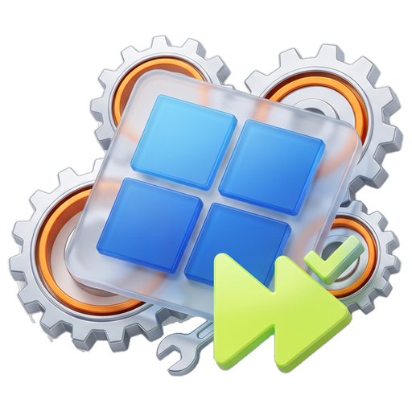
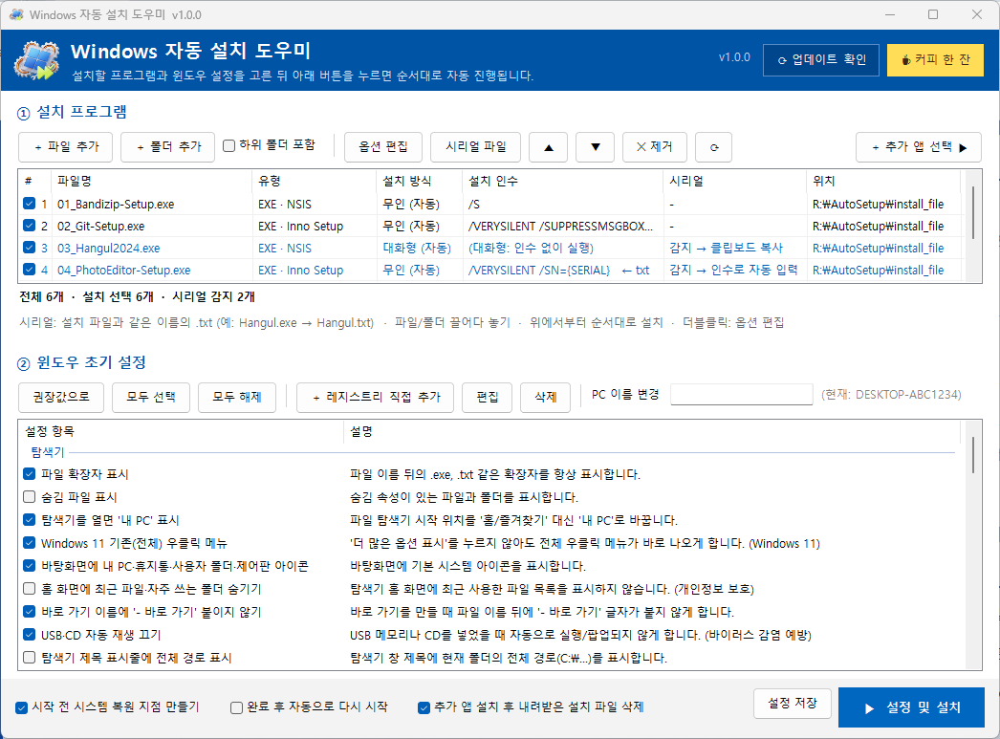
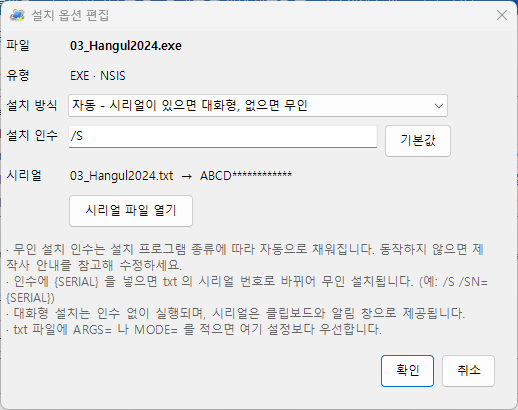
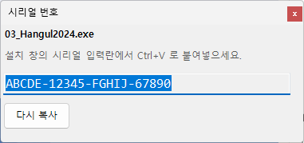
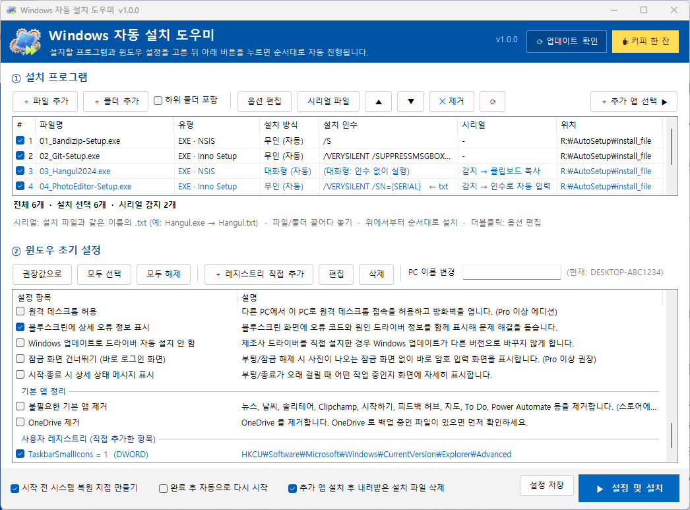
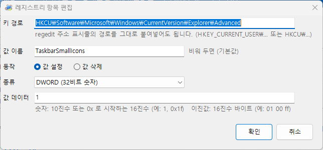
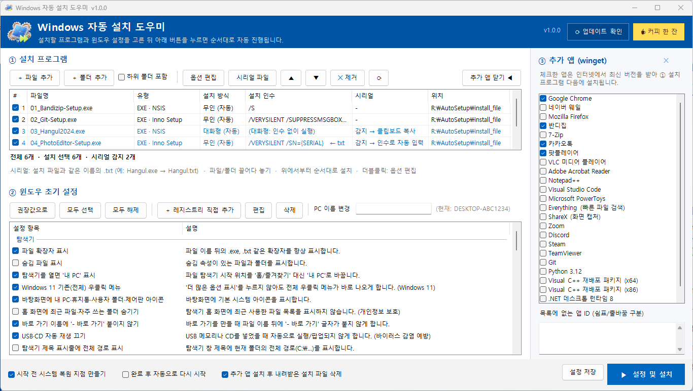
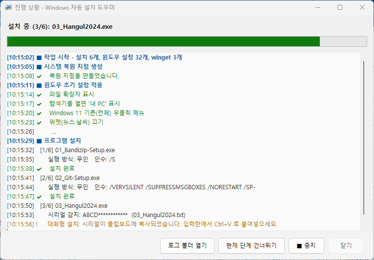
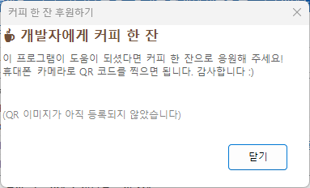

# 윈도우 새로 설치하고 1시간씩 걸리던 세팅, 버튼 한 번으로 끝내는 프로그램을 만들었습니다



윈도우를 새로 설치하면 할 일이 산더미입니다.

- 크롬, 카카오톡, 반디집, 한글… 설치 파일을 하나씩 실행하고 [다음] [다음] [동의] [설치]
- 시리얼 번호 찾아서 복사·붙여넣기
- 파일 확장자 보이게 하기, 작업 표시줄 정리, 광고·추천 앱 끄기, 절전 설정, NumLock…

회사 PC나 지인 PC까지 세팅하다 보면 매번 같은 일을 반복하게 됩니다.
그래서 **설치 파일 + 시리얼 번호 + 윈도우 초기 설정을 한 번에 자동으로 처리하는 프로그램**을 만들었습니다.
무료이고, 소스도 GitHub 에 공개되어 있습니다.

> 📥 **다운로드**: https://github.com/grasion/windows-auto-setup/releases/latest
> (`AutoSetup.exe` 하나만 받으면 됩니다. 설치 필요 없음)

---

## 한눈에 보기



한 화면에서 위에서부터 순서대로 고르면 됩니다.

1. **① 설치 프로그램** – 설치할 파일 목록 (설치 순서대로)
2. **② 윈도우 초기 설정** – 체크만 하면 적용되는 50가지 설정
3. **③ 추가 앱** – 크롬·카카오톡처럼 인터넷에서 바로 받아 설치할 앱

그리고 맨 아래 **[▶ 설정 및 설치]** 버튼 한 번이면 끝입니다.
(설치할 프로그램 없이 윈도우 설정만 바꾸고 싶으면 버튼이 **[▶ 설정 적용]** 으로 바뀝니다)

---

## 주요 기능

### 1. 설치 파일을 넣어 두기만 하면 순서대로 자동 설치

`AutoSetup.exe` 옆의 `install_file` 폴더에 설치 파일을 넣어 두면 프로그램을 켤 때 자동으로 목록에 올라옵니다.
[＋ 파일 추가] / [＋ 폴더 추가] 버튼이나 **끌어다 놓기**로도 추가할 수 있고, ▲▼ 버튼으로 설치 순서를 바꿀 수 있습니다.

설치 파일 종류(NSIS, Inno Setup, MSI, InstallShield 등)를 **자동으로 알아내서 창 없이 설치하는 옵션(무인 설치)** 까지 알아서 채워 줍니다.
그래서 대부분의 프로그램은 [다음] 버튼을 누를 필요 없이 조용히 설치됩니다.



목록에서 항목을 더블클릭하면 설치 방식과 옵션을 직접 바꿀 수도 있습니다.

### 2. 시리얼 번호는 txt 파일 하나로 해결

시리얼이 필요한 프로그램은 **설치 파일과 같은 이름의 txt 파일**에 시리얼을 적어 두기만 하면 됩니다.

```
install_file\
    Hangul2024.exe
    Hangul2024.txt     ← 여기에 시리얼 번호 한 줄
```

설치가 시작되면 시리얼이 **자동으로 클립보드에 복사**되고, 화면 오른쪽 아래에 시리얼 알림 창이 뜹니다.
설치 화면의 시리얼 입력란에서 `Ctrl + V` 만 누르면 끝!



설치 프로그램이 명령줄로 시리얼을 받을 수 있는 경우에는 txt 에 이렇게 적으면 **시리얼 입력까지 완전 자동**으로 설치됩니다.

```
SERIAL=ABCDE-12345-FGHIJ-67890
ARGS=/S /SERIAL={SERIAL}
```

### 3. 윈도우 초기 설정 50가지를 체크 한 번으로



윈도우 설치 후 다들 한 번씩은 찾아서 바꾸는 설정들을 모아 두었습니다. 기본으로 체크된 항목이 추천 설정이고, **[권장값으로]** 버튼으로 언제든 되돌릴 수 있습니다.

| 분류 | 예시 |
|---|---|
| 탐색기 | 파일 확장자 표시, 시작 위치 '내 PC', **윈도우 11 예전 우클릭 메뉴**, '- 바로 가기' 글자 제거, USB 자동 재생 끄기 |
| 작업 표시줄 | 검색창 아이콘으로 줄이기, 위젯·채팅·Copilot 버튼 숨기기, 시계에 초 표시, 왼쪽 정렬 |
| 개인정보·광고 | 광고 ID 끄기, 시작 메뉴 추천 앱·광고 끄기, 진단 데이터 최소화, Recall 끄기 |
| 전원·성능 | 빠른 시작 끄기, 전원 연결 시 절전 안 함, 시작 프로그램 지연 없애기, 게임 바 녹화 끄기 |
| 시스템 | 부팅 시 NumLock 켜기, Shift 5번 고정 키 팝업 끄기, 업데이트 자동 재시작 막기, 블루스크린 상세 정보 |
| 기본 앱 정리 | 뉴스·날씨·솔리테어 같은 기본 앱 제거, OneDrive 제거 |

PC 이름 변경도 같은 화면에서 할 수 있습니다.

#### 원하는 레지스트리 값도 직접 추가

목록에 없는 설정은 **[＋ 레지스트리 직접 추가]** 로 넣을 수 있습니다. regedit 주소창에 보이는 경로를 그대로 붙여넣으면 되고, 추가한 값은 저장되어 다음에도 그대로 적용됩니다.



### 4. 크롬·카카오톡 같은 앱은 인터넷에서 바로 설치



**[＋ 추가 앱 선택 ▶]** 을 누르면 오른쪽에 자주 쓰는 앱 목록이 열립니다. 체크만 하면 설치 파일을 따로 받을 필요 없이 **항상 최신 버전**을 내려받아 설치합니다.
(크롬, 웨일, 반디집, 7-Zip, 카카오톡, 팟플레이어, VLC, 아크로뱃 리더, VS Code, Visual C++ 재배포 패키지 등)

내려받은 설치 파일은 설치가 끝나면 자동으로 지워져서 디스크에 찌꺼기가 남지 않습니다.
(직접 넣어 둔 `install_file` 폴더의 설치 파일은 다른 PC에 또 쓸 수 있도록 **지우지 않습니다**)

### 5. 진행 상황 확인



버튼을 누르면 진행 상황 창이 뜨고 어떤 작업을 하고 있는지 실시간으로 보여 줍니다.
설치 화면이 멈춘 것 같을 때는 **[현재 단계 건너뛰기]** 로 다음 항목으로 넘어갈 수 있고, 모든 기록은 `logs` 폴더에 저장됩니다.

---

## 사용 방법

1. [GitHub 릴리스 페이지](https://github.com/grasion/windows-auto-setup/releases/latest)에서 `AutoSetup.exe` 를 받습니다.
2. USB 같은 곳에 폴더를 하나 만들고 `AutoSetup.exe` 를 넣습니다.
3. 같은 폴더에 `install_file` 폴더를 만들고 설치 파일을 넣습니다. (시리얼이 필요하면 같은 이름의 txt 도 함께)
4. `AutoSetup.exe` 실행 → 관리자 권한 확인 창에서 **[예]**
5. 설치할 프로그램, 윈도우 설정, 추가 앱을 고르고 **[▶ 설정 및 설치]** 클릭!

설정은 `settings.json` 에 저장되므로, USB 를 들고 다니면서 **다음 PC 에서는 실행하고 버튼만 누르면 됩니다.**

```
USB\
  AutoSetup\
    AutoSetup.exe
    settings.json      ← 내가 고른 설정 (자동 저장)
    install_file\
      01_Bandizip-Setup.exe
      02_Hangul2024.exe
      02_Hangul2024.txt
      ...
```

---

## 안심하고 쓰도록 넣어 둔 기능

- **시스템 복원 지점 자동 생성** – 작업 전에 복원 지점을 만들어 두기 때문에 문제가 생기면 이전 상태로 되돌릴 수 있습니다.
- **로그에 시리얼은 일부만 기록** – `ABCD****` 처럼 가려서 남깁니다.
- **자동 업데이트** – 새 버전이 나오면 프로그램을 켤 때 알려 주고, [예] 한 번이면 알아서 교체 후 다시 시작합니다. 내려받은 파일은 SHA256 값으로 검증합니다.
- **오픈 소스** – 무엇을 바꾸는지 모든 코드가 GitHub 에 공개되어 있습니다.

## 자주 묻는 질문

**Q. 따로 설치해야 하나요?**
아니요. 윈도우 10/11 에 기본으로 들어 있는 .NET Framework 로 동작해서 `AutoSetup.exe` 하나만 있으면 됩니다.

**Q. "Windows의 PC 보호" 파란 창이 떠요.**
인터넷에서 받은 서명 없는 프로그램이라 처음 실행할 때 나올 수 있습니다. [추가 정보] → [실행] 을 누르면 됩니다.

**Q. 어떤 프로그램은 설치 화면이 그대로 떠요.**
무인 설치를 지원하지 않는 설치 파일입니다. 목록에서 더블클릭해 설치 방식을 "대화형" 으로 바꾸고 직접 진행하면 됩니다.

**Q. 윈도우 설정은 누구 계정에 적용되나요?**
프로그램을 실행한 사용자 계정에 적용됩니다. 설정할 계정으로 로그인해서 실행하세요.

---

## ☕ 커피 한 잔



프로그램 오른쪽 위의 **[☕ 커피 한 잔]** 버튼을 누르면 후원 QR 코드가 나옵니다.
도움이 되셨다면 커피 한 잔으로 응원해 주세요. 큰 힘이 됩니다!

버그 제보나 기능 제안은 [GitHub Issues](https://github.com/grasion/windows-auto-setup/issues) 에 남겨 주세요.

---

**태그**: #윈도우설치 #윈도우11 #윈도우초기설정 #프로그램자동설치 #무인설치 #PC세팅 #윈도우최적화 #무료프로그램 #오픈소스
